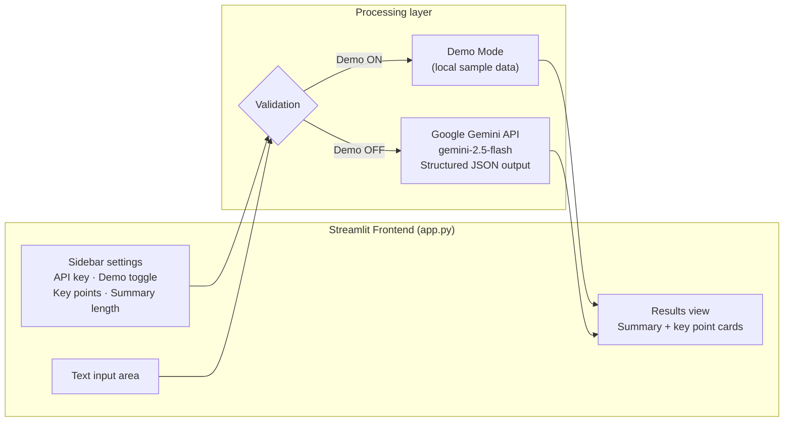

# 📝 Smart Text Summarizer & Key Points Analyzer

A lightweight web app that turns long texts into a concise summary and a structured list of key points. Built with **Streamlit** and powered by the **Google Gemini API** with schema-enforced **structured JSON output**.

Paste any article, report, or essay, choose how long the summary should be and how many key points you want, and get a clean, readable analysis in seconds, in the same language as the input text (Hebrew and English included).

---

## ✨ Key Features

| Feature | Description |
| --- | --- |
| **Adjustable summary length** | Choose between *Short* (2-3 sentences), *Medium* (one paragraph), or *Detailed* (2-3 paragraphs). |
| **Configurable key points** | Select between 3 and 10 key points; each has a title and a short explanation. |
| **Multilingual support** | The output language follows the input language. Full support for Hebrew and other non-English texts. |
| **Built-in Demo Mode** | A sidebar toggle simulates processing and returns sample output, so the app can be demonstrated on any machine **without an API key**. |
| **Structured, reliable output** | The model is constrained to a fixed JSON schema, so the UI never has to parse free-form text. |
| **Input validation & error handling** | Handles missing keys, too-short or too-long input, blocked responses, and API errors gracefully. |
| **Live text statistics** | Word and character counters update as you type. |

---

## 🏗️ Architecture

The app follows a simple three-stage flow: **input → processing → output**.



### Components

1. **Frontend (Streamlit).** A single-page UI. The sidebar holds the settings; the main area holds the text input and results. Streamlit re-runs the script on every interaction, so the heavy logic is gated behind the **Summarize** button.
2. **Validation layer.** Checks for a missing API key, minimum and maximum text length, and surfaces friendly messages instead of raw exceptions.
3. **Backend (Google Gemini API).** The `google-genai` SDK sends the text together with a system instruction and a prompt describing the desired summary length and number of key points.
4. **Structured JSON output.** The request sets `response_mime_type="application/json"` and passes a Pydantic model as `response_schema`, so the response is guaranteed to match the schema:

   ```json
   {
     "summary": "string",
     "key_points": [
       { "title": "string", "detail": "string" }
     ]
   }
   ```

5. **Demo Mode.** A local function returns fixed sample data in the exact same shape as the real response, so the rendering code path is identical in both modes.

---

## 🚀 Getting Started

### Prerequisites

- Python 3.9 or newer
- A Gemini API key (a free key is available from [Google AI Studio](https://aistudio.google.com/apikey)), **not required for Demo Mode**

### Installation

```bash
# 1. Clone the repository
git clone https://github.com/<your-username>/<your-repo>.git
cd <your-repo>

# 2. (Optional) create a virtual environment
python -m venv .venv
source .venv/bin/activate        # Windows: .venv\Scripts\activate

# 3. Install dependencies
pip install streamlit google-genai
```

### Run

```bash
streamlit run app.py
```

The app opens in your browser at `http://localhost:8501`.

### Configuration

You can provide the API key in either of two ways:

- **In the UI:** paste it into the **Gemini API Key** field in the sidebar.
- **Via environment variable** (pre-fills the field automatically):

  ```bash
  export GEMINI_API_KEY="your-key-here"     # Windows (PowerShell): $env:GEMINI_API_KEY="your-key-here"
  ```

To try the app without any key, switch on **Demo Mode (ללא API Key)** in the sidebar.

---

## 🧭 Usage

1. (Optional) Turn on **Demo Mode**, or enter your Gemini API key.
2. Choose the number of key points (3-10) and the summary length.
3. Paste your text into the input area.
4. Click **Summarize** and read the summary and expandable key point cards.

---

## ⚙️ Customization

| What | Where |
| --- | --- |
| Switch model (e.g. to `gemini-flash-latest`) | `MODEL` constant at the top of `app.py` |
| Change maximum input size | `MAX_CHARS` constant |
| Add or modify summary length options | `LENGTHS` dictionary |
| Change the output structure | `KeyPoint` and `SummaryResult` Pydantic models |

---

## 🧱 Project Structure

```
.
├── app.py        # Streamlit app: UI, validation, Gemini integration, Demo Mode
└── README.md
```

---

## ⚠️ Limitations

- Input is capped at 100,000 characters per request.
- Free-tier API keys are subject to rate limits; the app surfaces API errors in the UI.
- Demo Mode output is static and intentionally unrelated to the text entered.
- Summaries are generated by an AI model and should be reviewed for accuracy before being relied upon.

---

## 🔮 Possible Improvements

- File upload support (PDF / TXT / DOCX)
- Chunked, hierarchical summarization for very long documents
- Right-to-left (RTL) layout styling for Hebrew
- Export results to Markdown or PDF
- Storing the API key via `st.secrets` for deployed environments

---

## 🤖 AI-Assisted Development Workflow

This project was built with the help of **Claude (Anthropic)** as an AI pair-programming partner, while the design decisions, testing, and final integration remained my own responsibility. The workflow was iterative and conversational:

1. **Architecture planning.** I described the goal (a simple Streamlit app that summarizes long text and shows key points) and used Claude to define the high-level architecture: an input, processing, and output pipeline, with Streamlit's rerun model in mind. This led to gating the heavy logic behind a button and separating UI code from the model-calling function.
2. **Code generation and comprehension.** Claude produced the initial `app.py` and then walked through it block by block. This let me understand each part (sidebar settings, validation, the API call, rendering) rather than treating the code as a black box.
3. **Structured JSON handling.** Reliable machine-readable output was a core requirement. The first iteration asked the model for JSON through the prompt and defensively stripped code fences before parsing. After migrating to Gemini, we moved to native structured output (`response_mime_type` plus a Pydantic `response_schema`), keeping the exact same `summary` / `key_points` contract so the UI code needed no changes. Error handling covers malformed or blocked responses.
4. **Provider migration.** When I switched from the Anthropic API to Google Gemini (to use a free AI Studio key), Claude helped adapt the integration to the `google-genai` SDK while preserving the app's behavior and interface.
5. **Demo Mode.** To make the app easy to present on any computer, I asked for a toggle that bypasses the API entirely. Claude implemented a simulated-processing path that returns sample data in the same schema, relaxed the validation rules for that mode, and added a clear on-screen notice that demo output is not derived from the input.
6. **Review and verification.** I ran and tested the application myself, supplied the API key, chose the model and provider, and decided which features to add. AI-generated code was treated as a draft to be understood, tested, and adapted, not accepted blindly.

**Takeaway:** using an AI assistant shortened the path from idea to working prototype, but understanding the code, validating the behavior, and making the product decisions stayed with the developer.

---

## 🛠️ Tech Stack

- [Python](https://www.python.org/)
- [Streamlit](https://streamlit.io/): web UI
- [Google Gemini API](https://ai.google.dev/) via the [`google-genai`](https://pypi.org/project/google-genai/) SDK
- [Pydantic](https://docs.pydantic.dev/): response schema definition

---

## 📄 License

Add a license of your choice (for example, MIT) before publishing.
